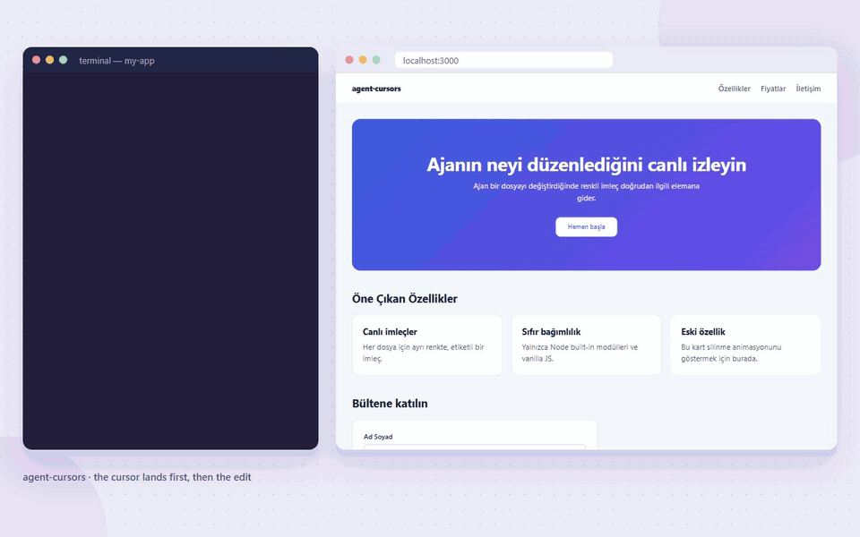

# agent-cursors

<p align="center">
  
</p>

While a coding agent edits a front-end file, a coloured cursor moves to the affected element on the page in your browser, and the change lands while the cursor is there. Works with Claude Code and Codex.

<sub>Unofficial; not affiliated with or endorsed by Anthropic or OpenAI. Claude and Claude Code are trademarks of Anthropic; Codex is a trademark of OpenAI.</sub>

## Install

Requires Node.js 18.3+ and Chrome.

```bash
git clone https://github.com/kadirdemirkaya/agent-cursors.git
cd agent-cursors
node setup.mjs
```

1. In Chrome, open `chrome://extensions` → turn on **Developer mode** → **Load unpacked** → select the `extension/` folder.
2. Restart Claude Code / Codex. In Codex, mark the hook as trusted under `/hooks`.

## Usage

Open your project on `localhost` as usual and work with the agent. When it edits a front-end file, a cursor moves to that spot on the page and the change lands right after. Cursors only appear for files tracked by git.

Choose how many cursors you see from the extension icon: grouped, one per file, or one per change.

To try it without an agent:

```bash
node daemon.mjs                  # then open demo.html in the browser
node simulate.mjs --kind all
```

## Uninstall

```bash
node setup.mjs --uninstall
```

Then remove the extension from `chrome://extensions`.

## License

[MIT](https://github.com/kadirdemirkaya/agent-cursors/blob/main/LICENSE)
